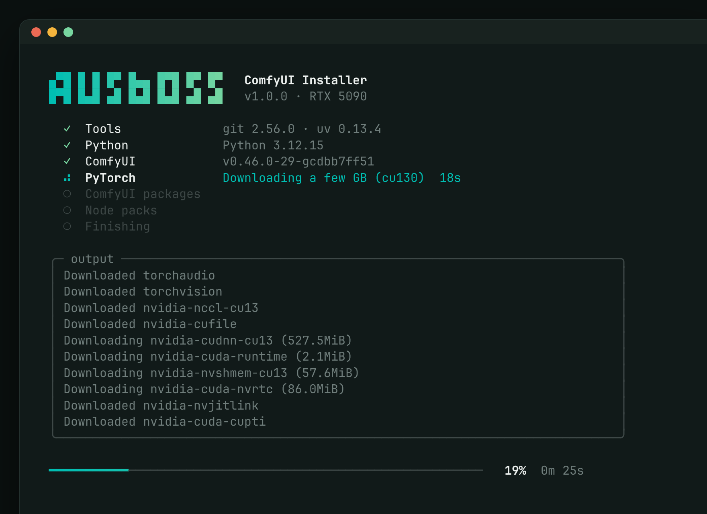

# ComfyUI AusBoss Installer

One script that installs **ComfyUI**, **ComfyUI-Manager** and the **[AusBoss nodes](https://github.com/ausboss/ComfyUI-AusBoss)** into a single portable folder, with its own Python. It doesn't touch your system Python, and you can delete the folder to remove everything.

Works on **Windows** and **Linux**, with **NVIDIA**, **AMD** (Linux) and **Intel Arc** GPUs.



## Install

### Windows

1. Make a folder with **no spaces** in its path, for example `C:\AI`.
2. Download [`install.bat`](https://github.com/ausboss/ComfyUI-AusBoss-Installer/releases/latest/download/install.bat) into it and double-click it.
3. When it's done, double-click **`ComfyUI-AusBoss\Start ComfyUI.bat`**.

If Windows SmartScreen warns you, click **More info**, then **Run anyway**. If you don't have Git, the installer gets a portable copy.

### Linux

You need `git` and `curl`. In the folder you want ComfyUI in:

```bash
curl -fsSLO https://raw.githubusercontent.com/ausboss/ComfyUI-AusBoss-Installer/main/install.sh && bash install.sh
```

Then start it with:

```bash
./ComfyUI-AusBoss/start.sh
```

ComfyUI opens at http://127.0.0.1:8188. The first install downloads a few GB, mostly PyTorch.

## What you get

```
ComfyUI-AusBoss/
├── ComfyUI/              ComfyUI itself. Models go in ComfyUI/models
├── venv/                 its own Python and packages
├── tools/                uv, Python, portable Git (Windows) and the download cache
├── nodes.txt             the node packs to install. Add your own
├── extra_args.txt        extra ComfyUI startup options, e.g. --listen
├── Start ComfyUI.bat     (start.sh on Linux)
└── Update ComfyUI.bat    (update.sh on Linux)
```

**Nodes it installs:**
- [ComfyUI-Manager](https://github.com/Comfy-Org/ComfyUI-Manager), so you can install any other pack from inside ComfyUI
- [ComfyUI-AusBoss](https://github.com/ausboss/ComfyUI-AusBoss): crop/rotate/pad, inpaint and stitch, masks by name or click, tiled upscale, video load/save, notes and callouts, and more

To add more packs, put a line in `nodes.txt` (`<git url> <folder name>`) and run the update script.

## Picking the GPU build

The installer looks at your GPU and picks PyTorch for you:

| GPU | PyTorch build |
| --- | --- |
| NVIDIA, driver 580 or newer | CUDA 13.0 (`cu130`) |
| NVIDIA, older driver | CUDA 12.8 (`cu128`) |
| AMD (Linux) | ROCm 7.1 (`rocm7.1`) |
| Intel Arc | XPU (`xpu`) |
| none of these | CPU (slow) |

To choose a build yourself, set `TORCH_INDEX`:

```bash
TORCH_INDEX=cu128 bash install.sh
```

On Windows, run `install.bat -TorchIndex cu128`.

Other options:

| Linux | Windows | What it does |
| --- | --- | --- |
| `--yes` | `-Yes` | Don't ask anything, just install |
| `--device nvidia\|amd\|intel\|cpu` | | Use this GPU type instead of the one found |
| `--no-shortcut` | `-NoShortcut` | No app menu entry (Linux) or desktop shortcut (Windows) |
| `bash install.sh ~/AI/ComfyUI` | `install.bat -Dir C:\AI\ComfyUI` | Install into another folder |

Everything the installer does is written to `install.log` in the install folder.

## Updating

Run **`Update ComfyUI.bat`** (or `update.sh`). It updates ComfyUI and every pack in `nodes.txt`, then reinstalls their packages. Packs you added through ComfyUI-Manager are updated from the Manager.

## Troubleshooting

- **"The install path has a space in it"**: move the installer to a path without spaces, such as `C:\AI` or `~/AI`.
- **Running on the CPU when you have an NVIDIA card**: update your GPU driver, then run the update script.
- **A node pack broke something**: delete its folder in `ComfyUI/custom_nodes`, or remove its line from `nodes.txt`.
- Anything else: [open an issue](https://github.com/ausboss/ComfyUI-AusBoss-Installer/issues).

## Uninstall

Delete the `ComfyUI-AusBoss` folder. Nothing is installed anywhere else, apart from uv's own folder if you already had uv.

## AusBoss

[Discord](https://discord.gg/RwVxY9Fuaj) · [Civitai](https://civitai.com/user/AusBoss) · [Hugging Face](https://huggingface.co/ausboss) · [AusBoss nodes](https://github.com/ausboss/ComfyUI-AusBoss)

MIT License.
